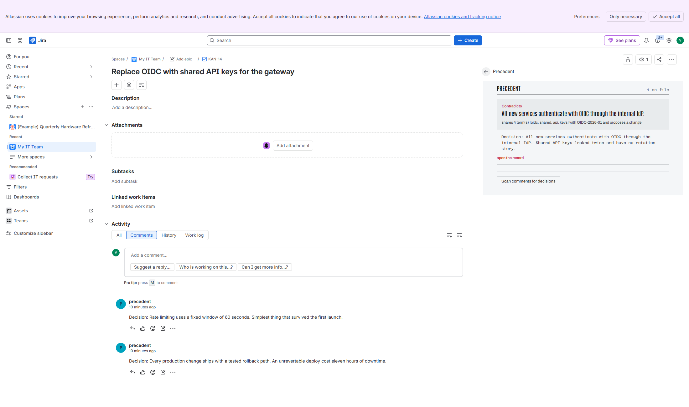
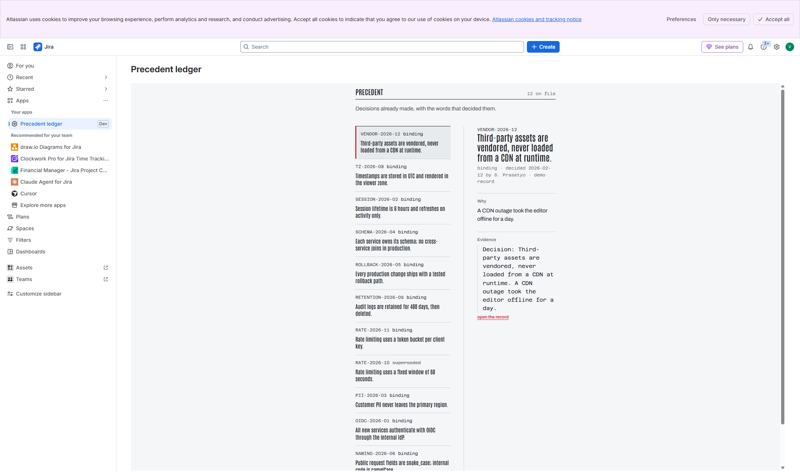

# Precedent

**The decision ledger for Jira.** It records the decisions a team already made, quotes
the comment that decided each one, and flags the next issue that runs against it —
before anyone builds the thing you already rejected.

Built for **Codegeist 2026**, category *Apps for Specialized Industries*, with the
**Best app with Atlassian MCP** bonus via `rovo:mcp`.

---

| In the work item | The ledger |
| --- | --- |
|  |  |

Both screenshots are from [precedent.atlassian.net](https://precedent.atlassian.net/browse/KAN-14).

## The problem, in one paragraph

A firm makes thousands of decisions and keeps none of them. They live in a comment on a
closed ticket, a page nobody reads, and the memory of whoever was in the room. Six months
later somebody opens a ticket to switch authentication to shared API keys, and the only
person who remembers *why that was rejected* has left. Agents make this worse: an LLM with
no memory of the decision will happily propose the thing you spent three months undoing.
Precedent is the memory, and it is citable.

## What it does

**1. It records decisions, not discussions.** A comment counts only when it says so —
it opens with `Decision:`, `Decided:` or `ADR:`. Everything else is noise and stays out of
the ledger.

**2. It catches the contradiction, in the panel.** Open an issue and the panel answers one
question: does this run against something we already decided?

> **Contradicts** — *All new services authenticate with OIDC through the internal IdP.*
> shares 3 term(s) [auth, token, shared] with OIDC-2026-01 and proposes a change

**3. Every claim opens its source.** The quote is the words that decided it; the link goes
straight to the comment, `…/browse/AUTH-142?focusedCommentId=10042`. No decision without
evidence — the app refuses to file one.

**4. It stays quiet when it should.** A shared project is not evidence. A decision only
surfaces when the issue actually shares a term with it, and a *contradiction* needs both
that overlap **and** a change verb (`replace`, `drop`, `switch`, `migrate`…). Precision is
the product: a panel that cries wolf gets switched off in a week.

**5. Agents can ask too.** Four tools over `rovo:mcp` — `check-precedent`, `find-decision`,
`record-decision`, `list-decision-chain` — plus a shipped `rovo:agent` so a judge never has
to assemble one.

## No LLM in the app

The matching is deterministic: keyword sets, a change-verb test, project/component scope.
Same input, same verdict, every time, and it is covered by assertions. The language model
lives where it belongs — in the agent that *asks* Precedent a question. This is a
deliberate non-goal, not a shortcut.

## Try it in five minutes

You need a free Atlassian Cloud site and Node 18+. No card, no paid plan.

```bash
npm i -g @forge/cli
forge login                      # opens a browser; sign in yourself

git clone https://github.com/<you>/precedent.git
cd precedent/app
npm install
npm run build

forge register                   # creates your own app and writes app.id
forge deploy -e development
forge install                    # pick your site, product: Jira
```

Then:

1. Open any issue. The **Precedent** panel is on the right.
2. Click **Load demo decisions**. It creates five issues and files twelve decisions.
3. Open the issues it lists. The panel **contradicts** the first three, marks the fourth
   **related**, and stays quiet on the fifth — that last one matters as much as the first.
4. Open **Apps → Precedent** for the ledger: every decision, its rationale, its evidence.
5. On any issue, click **Scan comments for decisions** to capture a real `Decision:` comment.

`forge register` is required because `app.id` belongs to the developer who deployed it.
Deleting the `app.id` line and running `forge register` gives you your own.

### Using the MCP tools from an agent

The `rovo:mcp` module exposes the four tools to Rovo. In **Rovo Studio**, create an agent
and add Precedent's tools from the app; the prompt in `manifest.yml` (`rovo:agent`) is the
one the app ships.

External MCP clients (Claude, Cursor) need the app's MCP endpoint enabled per install —
site admin → **Apps → Sites → Connected apps** — which is off by default on every Atlassian
site. The Rovo Studio path needs no admin toggle and is the one to use first.

## How it is built

| | |
|---|---|
| Runtime | Forge, `nodejs24.x`, 256 MB, no egress beyond the Jira REST API |
| UI | Custom UI, no framework — `ui/render.js` is pure DOM, `ui/app.js` holds the bridge |
| Storage | Forge KVS (`@forge/kvs`), one record per decision plus an id index |
| Matching | `src/lib/decisions.js` — pure, no Forge imports, unit-tested with plain `node` |
| Demo data | `src/lib/demo.js` — fixed rows, so the demo cannot fail on stage |

Modules: `jira:issuePanel`, `jira:globalPage`, `rovo:agent`, `rovo:mcp`, 4 `action`s,
5 `function`s. Scopes: `read:jira-work`, `write:jira-work`, `storage:app`. Nothing else.

### Why the panel is not a UI Kit component

The product's whole claim is *this is a record*. A record needs rules, numbered cases,
mono dates and a red mark that means one thing. UI Kit would have made it look like every
other app. The UI is ~290 lines of DOM and one stylesheet, with self-hosted fonts (Forge CSP
blocks Google Fonts inside the app, so the woff2 files ship with it).

## Verify it yourself

```bash
cd app
npm run check     # assertions: capture, parsing, contradiction rule, demo verdicts
npm run build
forge lint        # must report 0 issues
```

`npm run check` asserts the parts that are easy to get wrong and expensive to get wrong:

- `Decision:` prefix is required; ordinary chatter never becomes a decision
- a superseded decision can never be cited as binding
- a shared project alone does **not** put a decision on the panel
- a contradiction needs overlap **and** a change verb
- the seeded demo produces exactly `contradicts, contradicts, contradicts, related, unrelated`

## Repo layout

```
app/            the Forge app
  manifest.yml  modules, actions, scopes
  src/index.js  resolvers + the four MCP tool handlers
  src/lib/      pure logic (decisions.js) and the demo dataset (demo.js)
  src/seed.js   creates the demo issues, files the demo decisions
  ui/           render.js (pure), app.js (bridge), preview.html (no-Jira preview)
  test/         assertions, plain node
landing/        the marketing page (plain HTML/CSS, no build)
spike/          the rovo:mcp feasibility spike, kept as evidence
```

## Licence

MIT. See [LICENSE](./LICENSE).

Hero photograph: Ralf Roletschek, CC BY 3.0, via Wikimedia Commons — credited in the
landing page footer.
